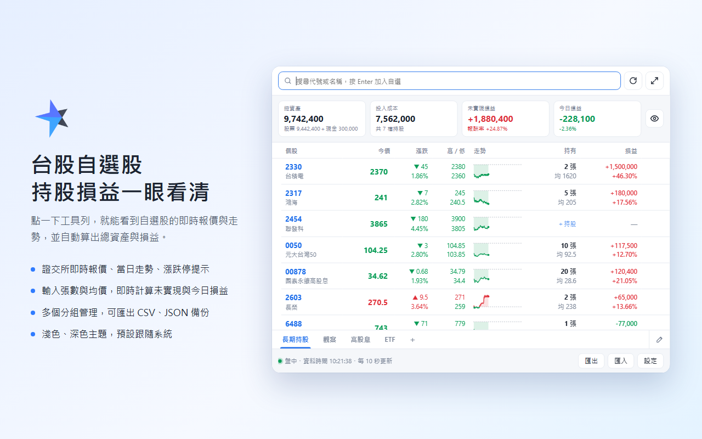
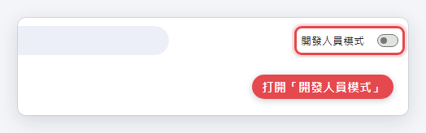
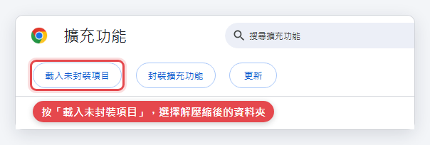
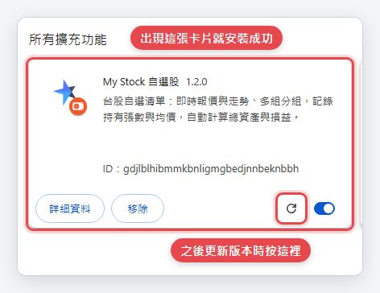
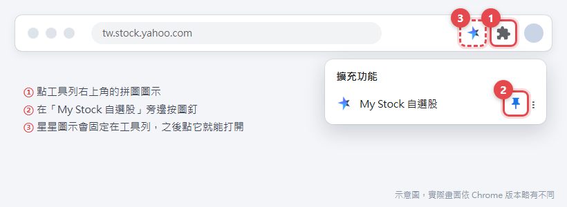
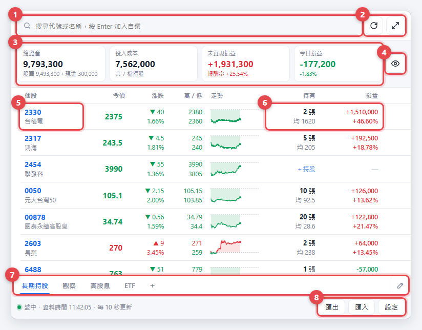
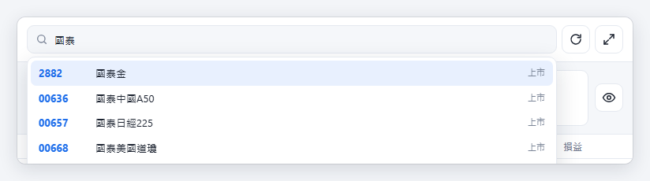
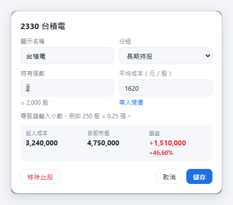
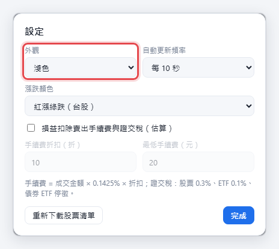
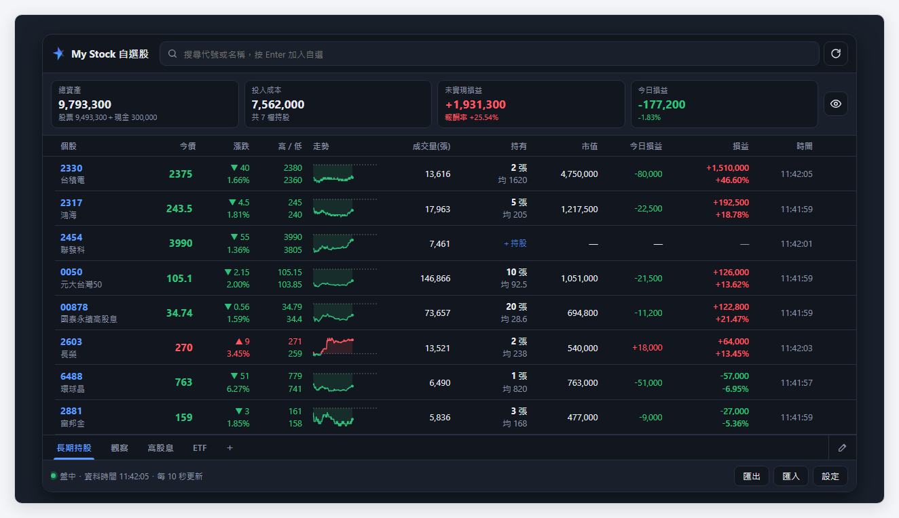

# My Stock 自選股

台股自選清單的 Chrome 擴充功能。點一下工具列圖示，就能看到自選股的即時報價與走勢，輸入持有張數與均價後，自動算出總資產與損益。



## 功能

- **即時行情**：證交所即時報價、漲跌、最高／最低、當日走勢圖，漲停跌停會反白
- **持股損益**：輸入張數（零股可用小數）與均價，即時計算總資產、投入成本、未實現損益、報酬率、今日損益
- **交易成本估算**：可選擇扣除賣出手續費（可設折扣）與證交稅
- **多個分組**：每組有自己的清單、持股與現金部位
- **匯出匯入**：CSV（Excel 可直接開啟）、JSON 完整備份、複製到剪貼簿
- **一鍵查詢**：點個股開啟 Yahoo 奇摩股市個股頁
- **其他**：大畫面模式、隱藏金額、淺色／深色主題（預設跟隨系統）、紅漲綠跌／綠漲紅跌

---

## 安裝

### 方法一：Chrome 線上應用程式商店（建議）

商店版本目前審查中，上架後會把連結放在這裡。商店版一鍵安裝、會自動更新，也不需要開啟開發人員模式。

### 方法二：手動安裝

適用 Chrome、Edge 等以 Chromium 為基礎的瀏覽器。

#### 步驟 1：下載並解壓縮

1. 到 [Releases 頁面](../../releases/latest) 下載最新版的 `my-stock-x.x.x.zip`
2. 把 ZIP **解壓縮到一個固定的資料夾**，例如 `D:\My-Stock`

> ⚠️ 安裝後**不能刪除或搬移**這個資料夾，Chrome 每次都會從這裡讀取擴充功能。
> 打開資料夾時，應該直接看到 `manifest.json`，而不是又多一層資料夾。

#### 步驟 2：打開開發人員模式

在 Chrome 網址列輸入 `chrome://extensions` 後按 Enter，打開右上角的「開發人員模式」。



#### 步驟 3：載入擴充功能

按左上角出現的「載入未封裝項目」，選擇步驟 1 解壓縮的資料夾（例如 `D:\My-Stock`），再按「選擇資料夾」。



出現「My Stock 自選股」的卡片就安裝成功了。



#### 步驟 4：釘選到工具列

點工具列右上角的拼圖圖示，在「My Stock 自選股」旁邊按圖釘。之後點工具列上的星星圖示就能打開。



---

## 使用說明

第一次打開時，第 1 組會先放好 2330、2454、0050 當範例，可以直接刪除。



| 編號 | 功能 |
| --- | --- |
| ① | 搜尋代號或名稱，按 Enter 加入自選 |
| ② | 立即更新報價／在新分頁以大畫面開啟 |
| ③ | 總覽：總資產、投入成本、未實現損益、今日損益（只計算目前分組） |
| ④ | 隱藏所有金額，方便截圖或分享畫面 |
| ⑤ | 點個股開啟 Yahoo 奇摩股市個股頁 |
| ⑥ | 點「持有」或「損益」輸入張數與均價 |
| ⑦ | 分組分頁：點一下切換、雙擊改名、＋ 新增 |
| ⑧ | 匯出、匯入、設定 |

### 加入股票

在搜尋框輸入代號或名稱（例如 `2330`、`台積電`、`國泰`），用方向鍵選擇，按 Enter 加入。上市、上櫃股票與 ETF 都可以搜尋。



### 輸入持股

點個股的「＋持股」或 ✎，輸入持有張數與平均成本，下方會即時預覽成本、市值與損益。

- 零股請用小數，例如 250 股 = `0.25` 張
- 「帶入現價」可以把目前股價填入均價
- 「分組」可以把這檔股票移到其他分組



### 整理清單

- **排序**：拖曳個股左側的 ⋮⋮
- **移到其他分組**：把 ⋮⋮ 拖到下方的分組分頁上
- **移除**：按右側的 ✕，誤刪可以按「復原」
- **分組改名、設定現金、刪除**：雙擊分頁，或按分頁列右側的 ✎

### 設定

按右下角「設定」可以調整：

- **外觀**：跟隨系統（預設）、淺色、深色
- **自動更新頻率**：5～60 秒
- **漲跌顏色**：紅漲綠跌（台股）或綠漲紅跌（美股）
- **交易成本**：損益是否扣除賣出手續費（可設折扣與最低手續費）與證交稅



### 大畫面模式

按右上角的 ⤢ 會在新分頁開啟，多顯示成交量、市值、今日損益與資料時間。



### 匯出與匯入

- **匯出 CSV**：目前分組，Excel 可以直接開啟
- **匯出 JSON**：所有分組的完整備份，換電腦時用來還原
- **匯入**：支援本工具的 JSON／CSV，或直接貼上代號清單（`2330, 0050, 2454`）

---

## 更新版本（手動安裝）

1. **建議先備份**：按「匯出 → JSON：完整備份」
2. 下載新版 ZIP，解壓縮後**覆蓋原本的資料夾**（位置不要變）
3. 到 `chrome://extensions`，按 My Stock 卡片上的 ↻（重新載入）

> 自選清單存在瀏覽器裡，綁定擴充功能的安裝位置。只要資料夾位置不變，更新後清單都會保留；如果換了位置，Chrome 會當成另一個擴充功能，清單會是空的，這時用 JSON 備份匯入即可。

## 常見問題

**報價沒有更新？**
盤中（09:00–13:30）會依設定頻率自動更新；收盤後與週末每 5 分鐘更新一次。也可以按右上角的 ⟳ 立即更新。

**擴充功能出現錯誤或消失？**
通常是解壓縮的資料夾被刪除或搬移了。請重新解壓縮到原本的位置，再到 `chrome://extensions` 按 ↻。

**公司電腦無法開啟開發人員模式？**
公司統一管理的電腦可能禁止這個功能，請等商店版上架後從商店安裝，或詢問公司 IT。

**換電腦怎麼辦？**
在舊電腦匯出 JSON 完整備份，新電腦安裝後用「匯入」還原。

## 隱私權

自選清單、持股與設定只存在你的瀏覽器裡，不會上傳到任何伺服器；查詢報價時只會送出股票代號。詳見[隱私權政策](https://sites.google.com/view/mystock-privacy)。

## 資料來源與聲明

| 用途 | 來源 |
| --- | --- |
| 即時報價 | 臺灣證券交易所 基本市況報導 |
| 當日走勢 | Yahoo 奇摩股市；失敗時改用 Yahoo Finance |
| 名稱搜尋 | 證交所、櫃買中心 OpenAPI |

本專案與上述機構沒有任何關聯。資料僅供參考，不構成投資建議；手續費與稅額為估算值，請以券商對帳單為準。

---

## 開發者

```
manifest.json        擴充功能設定（Manifest V3）
popup.html/.css/.js  彈出視窗與大畫面介面
theme.js             開啟前先套用淺色／深色主題，避免閃爍
lib/api.js           報價、走勢、股票清單抓取
lib/portfolio.js     損益計算與數字格式
lib/store.js         儲存（chrome.storage.local）
icons/               圖示
docs/images/         說明文件圖片
store/               上架用資料：截圖、宣傳圖塊、商店說明、隱私權政策
```

不需要建置步驟，修改後到 `chrome://extensions` 按 ↻ 即可看到變更。

## 授權

[MIT License](LICENSE)
